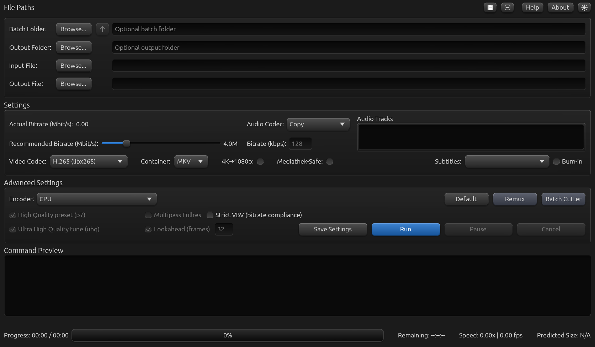

# FFmpeg CC GUI 0.95

**A graphical front end for ffmpeg, for Windows and Linux.** Convert videos with hardware encoders (NVIDIA NVENC, AMD AMF, Intel QSV) or in software, run whole folders as a batch, pick audio tracks and subtitles, keep Dolby Atmos intact and remux MKV to MP4 - all in one window. One program file, no Python needed.

**[Download FFmpeg CC GUI 0.95](https://github.com/WaveboSF/FFmpeg-CC-GUI/releases/tag/v0.95)**

*FFmpeg CC GUI 0.95 on Linux - the empty window at the start.*

| Platform | Download | Checksum |
|---|---|---|
| Windows 10/11, x64 | [Zip](https://github.com/WaveboSF/FFmpeg-CC-GUI/releases/download/v0.95/FFmpeg-CC-GUI-0.95-windows-x64.zip) | [SHA-256](https://github.com/WaveboSF/FFmpeg-CC-GUI/releases/download/v0.95/FFmpeg-CC-GUI-0.95-windows-x64.zip.sha256) |
| Linux, x86-64, glibc 2.43+ | [Archive](https://github.com/WaveboSF/FFmpeg-CC-GUI/releases/download/v0.95/FFmpeg-CC-GUI-0.95-linux-x86_64.tar.gz) | [SHA-256](https://github.com/WaveboSF/FFmpeg-CC-GUI/releases/download/v0.95/FFmpeg-CC-GUI-0.95-linux-x86_64.tar.gz.sha256) |

Each download is one program file plus an optional install script for the current user, the icon and the licence notices.

## What it does

- **Hardware and software encoding:** NVENC, AMF and Quick Sync for AV1, HEVC and H.264, plus CPU encoders; every graphics card is listed in the Encoder box and only the codecs it can really encode are offered.
- **Batch Folder:** point at a folder, or open the file dialog and select the videos to convert; one folder up with a click.
- **Audio tracks and subtitles:** choose which tracks go along, copy or re-encode the audio; Dolby Atmos tracks are marked and protected.
- **Recommended bitrate and Command Preview:** see the ffmpeg command before you run it; after a run it tells the finished file, its size and how much was saved.
- **Remux:** MKV to MP4 without re-encoding, with a window that shows the workflow.
- **Several windows:** the program can be started more than once, for example one run per graphics card. Light and dark theme, Help and About inside the program.

## Requirements

`ffmpeg` and `ffprobe` 8.x (a full build on Windows, for example `winget install Gyan.FFmpeg`); the program checks this at every start and says what is missing. Linux needs glibc 2.43 or newer (Ubuntu 26.04 or newer). The Windows file is not code-signed, so SmartScreen may warn on first start. AMD and Intel encoding is less tested than NVIDIA. No macOS build is published.

## Together with Batch Cutter

FFmpeg CC GUI belongs together with **[Batch Cutter](https://github.com/WaveboSF/Batch-Cutter)**, a lossless batch cutter from the same author: mark the cut once and every file of a folder is cut at the same point, without re-encoding. The **Batch Cutter** button starts it on the Batch Folder or the Input File.

## The Python version

FFmpeg CC GUI continues the Python program [FFmpeg Converter GUI 3.0.4](https://github.com/WaveboSF/FFmpeg-Converter-GUI), which stays there as it is and is no longer maintained.

## Contributors

FFmpeg CC GUI is built and maintained by [S.F. / WaveboSF](https://github.com/WaveboSF),
with plenty of help from **Anthropic Claude** and [**OpenAI Codex**](https://github.com/codex).
These advanced coding tools are part of the daily toolbox—from turning ideas
into code to tracking down stubborn bugs, testing and writing the docs. The
maintainer sets the direction, decides what ships—and occasionally says,
“No, that’s not what I meant,” because otherwise every video would come out as a perfectly tested, beautifully documented 0-byte file.

Three of us made this one: S.F. (direction and decisions), Claude from Anthropic and Codex from OpenAI.

The public repository contains downloads, documentation and notices; the application source remains private. MIT licence (`LICENSE`); the licences of the built-in libraries are listed in `LICENSES/THIRD-PARTY-CRATES.txt`.
